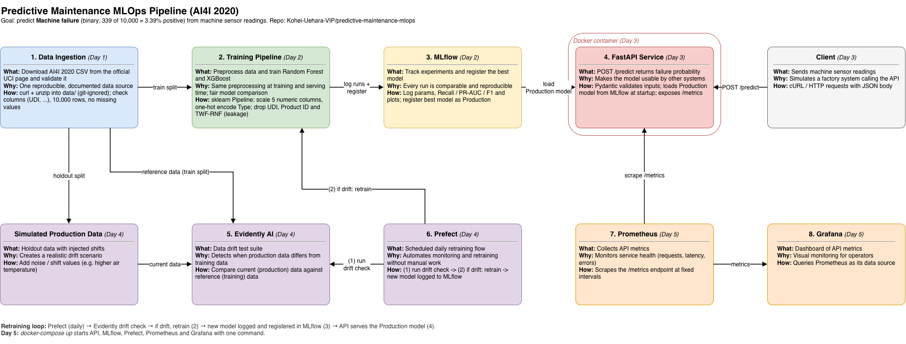
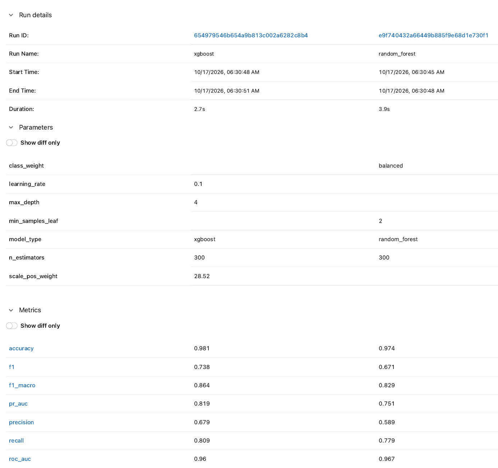
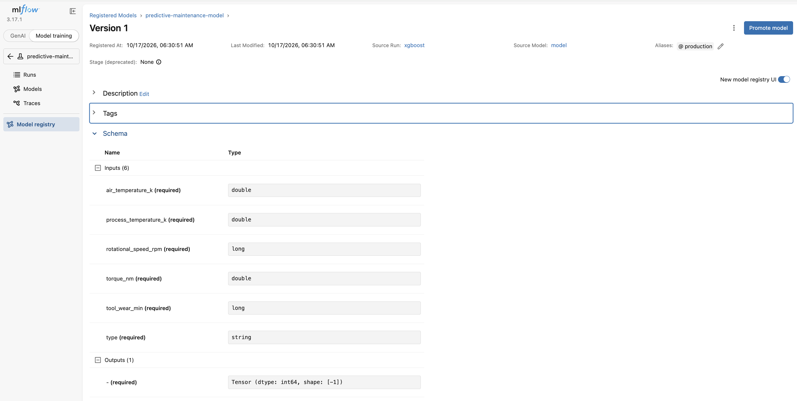
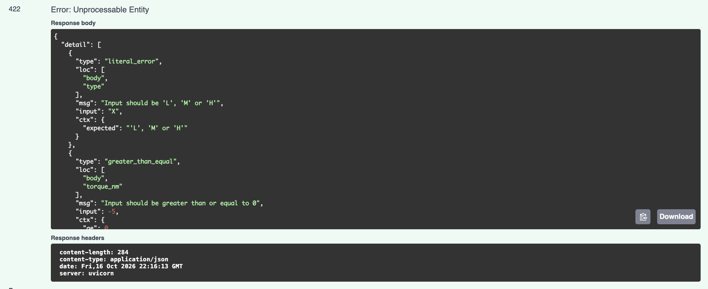
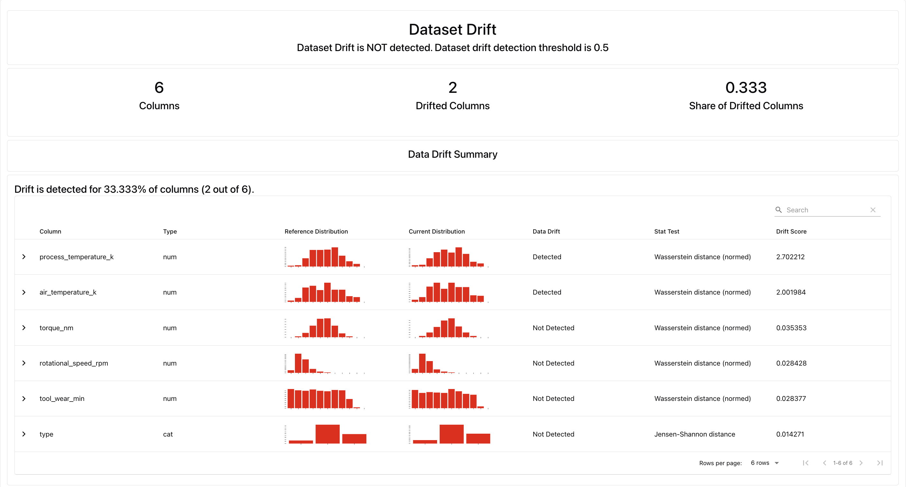
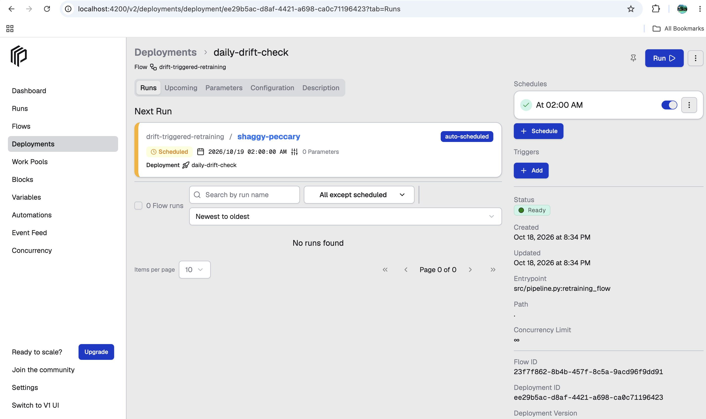
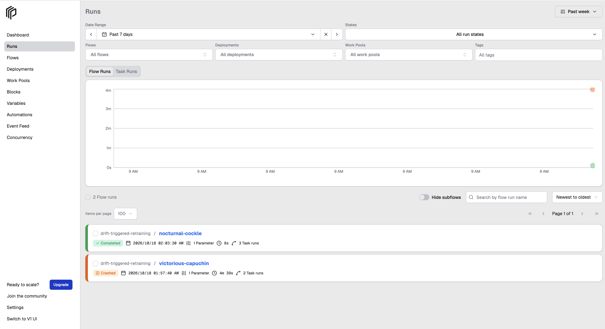
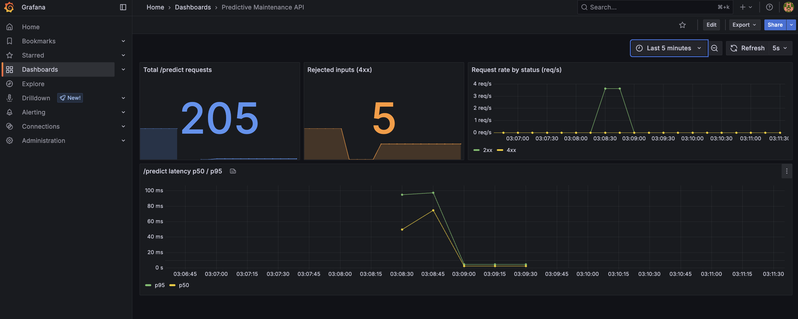
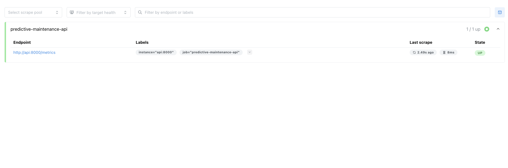

# Predictive Maintenance MLOps Pipeline

An end-to-end MLOps project that predicts machine failures from sensor data.
It covers the full lifecycle: data validation, experiment tracking, model registry,
a containerized prediction API, data drift detection, scheduled retraining and
live API monitoring — all started with one `docker compose` command.

> Week 10 capstone — Prime One Global ML Engineering Internship



## Contents

- [Business problem](#business-problem)
- [Dataset and data strategy](#dataset-and-data-strategy)
- [Modeling and results](#modeling-and-results)
- [Architecture](#architecture)
- [Project structure](#project-structure)
- [Setup](#setup)
- [API usage](#api-usage)
- [Drift detection and retraining](#drift-detection-and-retraining)
- [Monitoring](#monitoring)
- [Design decisions](#design-decisions)
- [Limitations and next steps](#limitations-and-next-steps)

## Business problem

Unplanned machine downtime is expensive: production stops, parts must be ordered in a
hurry, and a broken tool can damage the workpiece. If we can predict a failure *before*
it happens, maintenance can be scheduled at a convenient time.

The model answers one question for each sensor reading:
**"Is this machine likely to fail?"**

Because failures are rare, a model that always says "no failure" would already be
96.6% accurate — and completely useless. So the project is evaluated with metrics that
focus on the failure class: **recall** (how many real failures we catch),
**precision** (how many alarms are real) and **PR-AUC**.

## Dataset and data strategy

**AI4I 2020 Predictive Maintenance Dataset** (UCI Machine Learning Repository)

| Item | Value |
|---|---|
| Rows | 10,000 (one row per sensor reading) |
| Missing values | None |
| Target | `Machine failure` (0 / 1) |
| Failure rate | 339 / 10,000 = **3.39%** (strong class imbalance) |
| Features | `Type` (L / M / H product quality), air temperature, process temperature, rotational speed, torque, tool wear |

**Columns removed before training**

| Columns | Reason |
|---|---|
| `UDI`, `Product ID` | ID columns. Every value is unique, so they carry no pattern and could only let the model memorize rows. |
| `TWF`, `HDF`, `PWF`, `OSF`, `RNF` | **Data leakage.** These are the five failure modes. `Machine failure` is 1 when any of them is 1, so they are part of the answer and would not be available at prediction time. |

Note: the UCI page lists the ID column as `UID`, but the CSV header is `UDI`.
The code uses the actual CSV header and validates the expected columns and row count
when loading (`src/data.py`).

**Split:** 80% train / 20% test, **stratified** on the target so that both sets keep the
3.4% failure rate (train 3.39%, test 3.40%).

## Modeling and results

Both models use the same scikit-learn `Pipeline`:

- Numeric features: median imputation + `StandardScaler`
- `Type`: most-frequent imputation + `OneHotEncoder(handle_unknown="ignore")`

| Model | Imbalance handling | Key parameters |
|---|---|---|
| Random Forest | `class_weight="balanced"` | 300 trees, `min_samples_leaf=2` |
| XGBoost | `scale_pos_weight=28.52` (negatives / positives) | 300 trees, `max_depth=4`, `learning_rate=0.1` |

**Test set results (2,000 rows, 68 failures, threshold 0.5)**

| Metric | Random Forest | XGBoost |
|---|---|---|
| Accuracy | 0.974 | **0.981** |
| Precision | 0.589 | **0.679** |
| Recall | 0.779 | **0.809** |
| F1 | 0.671 | **0.738** |
| F1 (macro) | 0.829 | **0.864** |
| ROC-AUC | **0.967** | 0.960 |
| **PR-AUC** (selection metric) | 0.751 | **0.819** |

**XGBoost was selected** because it has the higher PR-AUC. PR-AUC was chosen as the
selection metric because, with only 3.4% positives, ROC-AUC looks good for almost any
model, while PR-AUC shows how well the model ranks the rare failures.
On the test set, XGBoost catches about 55 of the 68 failures (recall 0.809).

All runs, parameters, metrics, ROC curves, confusion matrices and feature importance
plots are logged to MLflow. The best model is registered as
`predictive-maintenance-model` with the alias **`@production`**.





## Architecture

| # | Component | Tool | What it does |
|---|---|---|---|
| 1 | Data ingestion | pandas | Loads the CSV, validates columns and row count, removes ID / leakage columns |
| 2 | Training pipeline | scikit-learn, XGBoost | Trains both models with the same preprocessing |
| 3 | Experiment tracking & registry | MLflow 3.17 | Logs runs, registers the best model, sets the `production` alias |
| 4 | Prediction API | FastAPI + Docker | Serves `/predict` with input validation and `/metrics` |
| 5 | Drift detection | Evidently 0.7 | Compares production data with the training data |
| 6 | Orchestration | Prefect 3.8 | Daily flow: drift check → retrain → export the new model |
| 7 | Metrics collection | Prometheus | Scrapes the API's `/metrics` every 5 seconds |
| 8 | Dashboard | Grafana | Shows request volume, rejected inputs and latency |

The editable diagram is in `docs/architecture.drawio`.

## Project structure

```
predictive-maintenance-mlops/
├── data/                       # dataset (not committed, see Setup)
├── docs/
│   ├── architecture.drawio     # architecture diagram (editable)
│   ├── architecture.png
│   └── screenshots/
├── models/
│   └── model_info.json         # name, alias, version and run ID of the exported model
├── monitoring/
│   ├── prometheus.yml          # scrape config
│   └── grafana/                # datasource + dashboard provisioning
├── notebooks/
│   └── 01_eda.ipynb            # exploratory data analysis
├── reports/
│   └── drift_summary.json      # result of the last drift check
├── src/
│   ├── config.py               # paths, column names, constants
│   ├── data.py                 # load, validate, prepare features, split
│   ├── preprocessing.py        # ColumnTransformer
│   ├── train.py                # train, log to MLflow, register best model
│   ├── export_model.py         # export the @production model to models/
│   ├── api.py                  # FastAPI app
│   ├── check_api_parity.py     # compares API predictions with the local model
│   ├── drift.py                # simulate production data + Evidently drift check
│   └── pipeline.py             # Prefect flow
├── Dockerfile                  # prediction API image
├── docker-compose.yml          # API, MLflow, Prefect, Prometheus, Grafana
├── requirements.txt            # full development environment
└── requirements-api.txt        # minimal dependencies for the API image
```

## Setup

Tested on macOS (Apple M1) with conda and Docker Desktop.

### 1. Clone and create the environment

```bash
git clone https://github.com/Kohei-Uehara-VIP/predictive-maintenance-mlops.git
cd predictive-maintenance-mlops

conda create -n predictive-maintenance-mlops python=3.11 -y
conda activate predictive-maintenance-mlops
conda install -c conda-forge xgboost=3.4.2 -y
pip install -r requirements.txt
```

XGBoost is installed from conda-forge first because version 3.4.2 is not on PyPI.
`pip` then sees it as already installed.

### 2. Download the dataset

```bash
curl -L -o data/ai4i2020.zip "https://archive.ics.uci.edu/static/public/601/ai4i+2020+predictive+maintenance+dataset.zip"
unzip -o data/ai4i2020.zip -d data/
```

### 3. Start MLflow and Prefect

```bash
docker compose up -d mlflow prefect
prefect config set PREFECT_API_URL=http://127.0.0.1:4200/api
```

MLflow runs on port **5001**, because port 5000 is used by AirPlay on macOS.

### 4. Train and export the model

```bash
python -m src.train          # trains both models, registers the best one as @production
python -m src.export_model   # saves the @production model to models/model.joblib
```

### 5. Start the whole stack

```bash
docker compose up -d --build
docker compose ps            # all 5 services should be "Up"
```

| Service | URL | Notes |
|---|---|---|
| Prediction API (Swagger UI) | http://localhost:8000/docs | |
| MLflow | http://localhost:5001 | |
| Prefect | http://localhost:4200 | |
| Prometheus | http://localhost:9090 | Status → Target health |
| Grafana | http://localhost:3000 | `admin` / `admin` (local demo only — change it in any shared environment) |

### 6. Run the drift check and retraining flow

```bash
python -m src.pipeline --run-once   # run the flow once now
python -m src.pipeline              # register the daily schedule (02:00 Asia/Tokyo) and wait
```

If the flow retrains the model, rebuild the API image so it serves the new version:

```bash
docker compose up -d --build api
```

## API usage

| Method | Path | Description |
|---|---|---|
| GET | `/health` | Health check |
| POST | `/predict` | Failure prediction for one sensor reading |
| GET | `/metrics` | Prometheus metrics |
| GET | `/docs` | Interactive Swagger UI |

**Valid request**

```bash
curl -X POST http://127.0.0.1:8000/predict \
  -H "Content-Type: application/json" \
  -d '{"type":"M","air_temperature_k":298.1,"process_temperature_k":308.6,"rotational_speed_rpm":1551,"torque_nm":42.8,"tool_wear_min":0}'
```

```json
{"failure_probability":0.0001,"predicted_failure":false,"threshold":0.5,"model_version":"2"}
```

**Input validation**

Every field is checked by a Pydantic schema before it reaches the model:

| Field | Rule |
|---|---|
| `type` | one of `L`, `M`, `H` |
| `air_temperature_k`, `process_temperature_k` | 250 – 350 K |
| `rotational_speed_rpm` | greater than 0, at most 5,000 |
| `torque_nm` | 0 – 150 |
| `tool_wear_min` | 0 – 400 |

The ranges are physical limits, not the training data range, so the API still accepts
unusual-but-possible readings (which is exactly what drift monitoring needs to see).
An invalid request returns **HTTP 422**:

```bash
curl -X POST http://127.0.0.1:8000/predict \
  -H "Content-Type: application/json" \
  -d '{"type":"X","air_temperature_k":298.1,"process_temperature_k":308.6,"rotational_speed_rpm":1551,"torque_nm":42.8,"tool_wear_min":0}'
```

```json
{"detail":[{"type":"literal_error","loc":["body","type"],"msg":"Input should be 'L', 'M' or 'H'", ...}]}
```



**Training / serving parity**

`python -m src.check_api_parity` sends all 200 rows of a test sample to the running API
and compares the answers with the model loaded locally:

```
Compared 200 rows | max abs diff = 0.000000 | mismatches = 0
```

## Drift detection and retraining

**Simulated production data** (`src/drift.py`): the test split with

- air temperature and process temperature **+4 K** (for example, a hotter season), and
- random noise added to torque (sensor noise).

**Evidently report:** `DataDriftPreset` compares the simulated data with the training data.
For numeric columns it uses the normalized Wasserstein distance with a threshold of 0.1.

| Column | Wasserstein distance (normed) | Drift |
|---|---|---|
| `air_temperature_k` | 2.00 | **Yes** |
| `process_temperature_k` | 2.70 | **Yes** |
| `rotational_speed_rpm`, `torque_nm`, `tool_wear_min`, `type` | below threshold | No |

2 of 6 columns drifted (share 0.33). Evidently's dataset-level rule needs 50% of
columns, so it does **not** flag the dataset as drifted. The project uses a stricter
policy: **retrain if any column drifts**, because temperature is directly linked to the
heat dissipation failure mode (HDF) — a shift there matters even if most columns are stable.



**Prefect flow** (`src/pipeline.py`) — `drift-triggered-retraining`

```
detect-data-drift ──► drift? ──yes──► retrain-model (retries=1) ──► export-production-model
                         └──no───► keep the current production model
```

It is served as the deployment `daily-drift-check` with a cron schedule
`0 2 * * *` in the `Asia/Tokyo` time zone.



The screenshot below shows the first two runs. The first run crashed because the
MLflow server had to be restarted after a dependency change (SQLAlchemy was pinned to
2.0.x, because 2.1 broke the Prefect scheduler). The second run completed: drift was
detected, both models were retrained and the new best model was registered as version 2.



## Monitoring

`prometheus-fastapi-instrumentator` exposes request counts and latency histograms on
`/metrics`. Prometheus scrapes it every 5 seconds, and Grafana is provisioned
automatically with a Prometheus data source and the **Predictive Maintenance API**
dashboard:

| Panel | Query idea |
|---|---|
| Total /predict requests | total request counter |
| Rejected inputs (4xx) | requests rejected by validation |
| Request rate by status | requests per second, split by 2xx / 4xx |
| Latency p50 / p95 | `histogram_quantile` over the latency buckets |

The latency buckets were set to 5 ms – 1 s. With the library's default buckets
(0.1, 0.5, 1 s) every request fell into the first bucket, so p50 and p95 were only
interpolated values (exactly 50 ms and 95 ms) instead of real measurements.



The dashboard above shows 200 valid and 5 invalid requests: all 5 invalid inputs were
rejected with 422, and after a short warm-up the latency stayed at a few milliseconds.



## Design decisions

- **Model alias instead of stages.** MLflow model stages are deprecated, so the best
  model gets the alias `@production`.
- **Model baked into the Docker image.** The API image contains the exported
  `models/model.joblib` instead of downloading the model from MLflow at startup.
  The API does not depend on the MLflow server being up, and each image is tied to one
  model version (recorded in `models/model_info.json`).
- **Python 3.12 in the image.** PyPI only provides recent XGBoost wheels for
  Python 3.12+. The image uses XGBoost 3.4.1 (closest PyPI release to the 3.4.2 used for
  training); the parity check confirms identical predictions.
- **Small, non-root image.** `python:3.12-slim`, minimal `requirements-api.txt`,
  `.dockerignore`, and the container runs as a non-root user.
- **Leakage removed on purpose.** The five failure-mode columns would give
  near-perfect scores but cannot be known before a failure happens.

## Limitations and next steps

- **Synthetic data.** AI4I 2020 is a synthetic dataset that reflects real machines,
  so the results show the method, not real factory performance.
- **Retraining uses the same training data.** In this demo the retrain step does not
  add new labeled data, so the new version has the same metrics. In production, the
  flow would retrain on recent labeled data and only promote the new model if it
  beats the current one.
- **Fixed threshold.** The decision threshold is 0.5. It should be tuned with the
  business cost of a missed failure versus a false alarm.
- **Local setup.** SQLite for MLflow, default Grafana credentials, and the Prefect flow
  is served from the host machine (it needs the training environment and the data).
  A production setup would use a database server, secrets management and a Prefect
  worker in its own container.
- **Monitoring the model, not only the API.** Next step: export the drift score and the
  prediction distribution to Prometheus and add Grafana alerts.

## Dataset citation

AI4I 2020 Predictive Maintenance Dataset [Dataset]. (2020). UCI Machine Learning
Repository. https://doi.org/10.24432/C5HS5C — licensed under CC BY 4.0.
Introductory paper: S. Matzka (2020).
